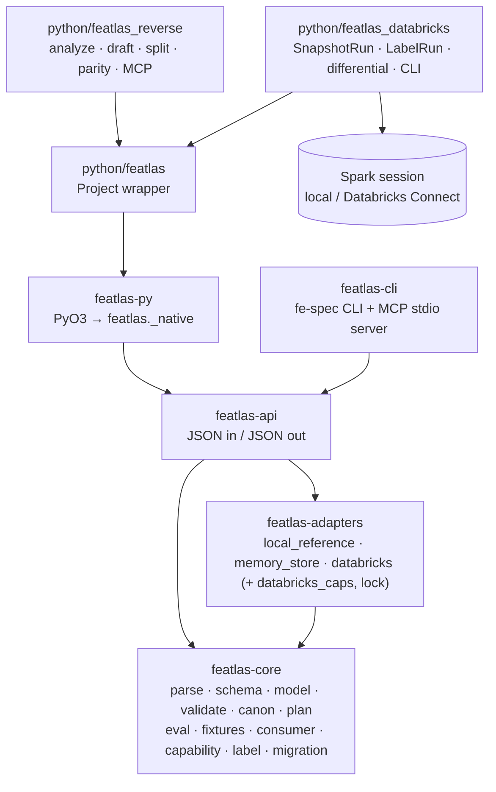
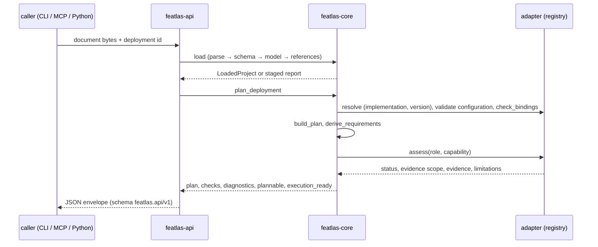
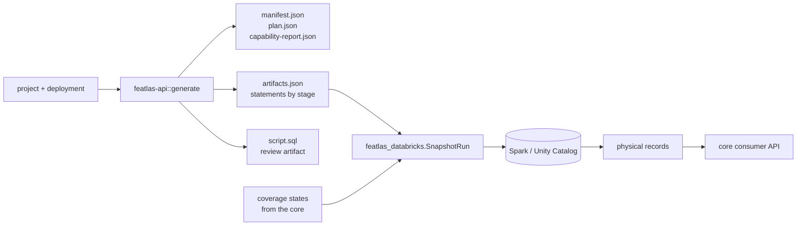

# Architecture

**In plain terms:** all of the meaning lives in one Rust library, `featlas-core`. Everything
else is a thin layer around it: adapters translate plans for a specific platform, a shared JSON
API wraps the core, and the CLI, the MCP server and the Python package all call that same API,
so they cannot disagree. The Databricks host only runs statements the core generated.

## Crates and packages

| Crate / package | Key dependencies (from its `Cargo.toml`) |
| --- | --- |
| `featlas-core` | `yaml-rust2`, `jsonschema` (default features off, workspace), `serde`, `serde_json`, `sha2`, `hex`, `regex` |
| `featlas-adapters` | `featlas-core`, `jsonschema`, `serde_json`, `sha2`, `hex` |
| `featlas-api` | `featlas-core`, `featlas-adapters`, `serde_json` |
| `featlas-cli` | `featlas-api`, `featlas-core`, `featlas-adapters`, `clap`, `rs-rich =0.0.15` (as `rich`), `jsonschema` |
| `featlas-py` | `featlas-api`, `featlas-core`, PyO3 0.30 (`abi3-py312`), built by maturin as `_native` |

The workspace is edition 2021 and declares `rust-version = "1.85"`; `featlas-cli` declares
`rust-version = "1.90"` because rs-rich needs it. All crates are `publish = false`; they ship
inside the `fe-spec` binary and the `featlas` wheel ([Releases](releases.md)).

### Boundaries (DECISIONS D1)

* The core has no vendor dependency, physical-coordinate assumption or vendor-name dispatch. This
  is enforced by `crates/featlas-adapters/tests/rebinding.rs::core_crate_has_no_vendor_dependencies`.
* Adapters are resolved through the `AdapterRegistry` / `StoreRegistry` traits by exact
  `(implementation, version)` (`capability.rs`, `consumer.rs`).
* `databricks.rs` only *generates* SQL text and statements: no I/O, no credentials, no SDK.
* The Python host contains no temporal, typing, null or selection rules; plans, code, coverage
  states and consumer selection come from the core in-process.

## Core modules

| Module | Responsibility |
| --- | --- |
| `parse.rs` | Restricted YAML/JSON profile (SEM-PARSE-001): one document; no anchors, aliases, merge keys, tags, duplicate or non-string keys; ambiguous plain scalars (`yes`, `~`, `.inf`, `0x1F`, `1_000`, `NULL`…), plain timestamps, non-finite numbers, out-of-range integers and `${…}` markers rejected; 4 MiB, depth 128, 2 M node limits. JSON goes through the same event builder (DECISIONS D3). |
| `schema.rs` | Embedded Draft 2020-12 registry of the twelve shipped schemas; the retriever refuses every URI. |
| `model.rs` | Typed model; every struct denies unknown fields (`SCHEMA_MODEL_CONFLICT` if schema and model disagree); no serde defaults. |
| `load.rs` | Staged loading parse → schema → model → references; each stage runs only if its prerequisite passed (SEM-CONF-001/002). |
| `validate.rs` | References, types, lineage, bindings; JSON-pointer paths and SEM rule on every diagnostic. |
| `canon.rs` | `featlas-canon/1` and the identity scopes ([Identity](concepts/identity.md)). |
| `plan.rs` | Target-neutral plan, derived requirements, digests. |
| `capability.rs` | Adapter traits, planning preflight, capability reports, report consistency checks. |
| `eval.rs`, `expr.rs`, `value.rs`, `time.rs` | Exact local evaluator, typed expressions, values, UTC instants. |
| `fixtures.rs` | Acceptance-suite runner; goldens read, never regenerated. |
| `consumer.rs` | Target-neutral consumer API and publication selection. |
| `label.rs` | Forward-horizon labels: `label_requests` (maturity/completeness, no data) and `build_labels`. |
| `migration.rs` | Store-migration plans (review artifact only). |
| `diag.rs` | Structured diagnostics ([Diagnostics](reference/diagnostics.md)). |

## The planner

`plan.rs` builds, per feature set and feature, the ordered stages an implementation must
preserve (source reconstruction, population, windows, joins, predicates, grouping, transform,
coverage, missingness, output contract, lineage, publication intent). The logical part references
logical sources and columns only; physical bindings are listed separately, so the logical plan
digest is identical across rebinding. `capability.rs::plan_deployment` resolves adapters, runs
each adapter's configuration-schema validation and `check_bindings` preflight (for Databricks:
`[catalog, schema]` namespaces, identifier rules, Delta format, table locations), derives
requirements and asks each adapter to assess each `(role, capability)`.

## The evaluator

The stage order is listed in [Time semantics](concepts/time.md#reconstruction-order-sem-rev-001).
Further properties (`eval.rs`, `expr.rs`, DECISIONS D4):

* every supplied row of every direct, transitive and population source is type- and
  nullability-checked before anything else;
* integer sums accumulate in i128 and return checked i64; number sums are correctly rounded
  (Shewchuk / `fsum`); means divide the exact sum;
* static types are memoized per expression node for one evaluation;
* evaluations are bounded by work, time and row limits (`Limits`; the CLI uses a 60 s deadline,
  `crates/featlas-cli/src/commands.rs`);
* learned and custom transforms are never executed.

## Canonical diagnostic precedence (DECISIONS D8)

When several violations co-occur, the core and the generated Spark SQL report the **first** of:

1. invalid source rows (sources in id order);
2. reconstruction of the population source (primary-key duplicates, logical-key conflicts or
   revision ties), then population duplicates;
3. reconstruction of every feature's available input sources in plan order (primary input, then
   join targets);
4. per feature in dependency order: for each join — invalid intervals, null join keys, one-to-one
   cardinality, multiple matches, unmatched rows; then reduce assertions over population entities
   — null input, null ordering key, lookup tie; then runtime errors of that feature (overflow,
   division by zero, non-finite, empty error); then that feature's output and quality rules
   (D12);
5. quarantine (D12), after every feature has passed its error-level rules;
6. snapshot assembly.

`python/featlas_databricks/runner.py::SnapshotRun.execute` runs untagged assertions first, then
per feature its tagged assertions, a materialization of its view and its quality rules, then
quarantine, and the differential harness
requires Spark's first code to equal the expected code
(`differential.py::_diag_outcome`). Two multi-violation differential tests cover this (EVIDENCE
review item D13).

## Transport parity

`crates/featlas-api/src/lib.rs` functions take exact document bytes plus a format and JSON
values, and return JSON with `"schema": "featlas.api/v1"` and an `operation`. Nothing there reads
files named inside documents, fetches URIs, deploys or publishes.

| Transport | Entry point | Notes |
| --- | --- | --- |
| CLI | `crates/featlas-cli/src/commands.rs` | Reads the file, calls the API or core, renders text with rs-rich (colour only on a terminal, `NO_COLOR` honoured) or prints JSON |
| MCP | `crates/featlas-cli/src/mcp.rs` | Same API functions; documents passed inline ([MCP server](reference/mcp.md)) |
| Python | `crates/featlas-py/src/lib.rs` | Same API functions; the GIL is released (`py.detach`) while the core runs |

Parity is tested by `python/tests/test_native.py::test_transport_parity_with_cli` and the CLI/MCP
tests in `crates/featlas-cli/tests/cli.rs`.

## Generated-code flow (Databricks)

Details: [Databricks guide](guides/databricks.md).
