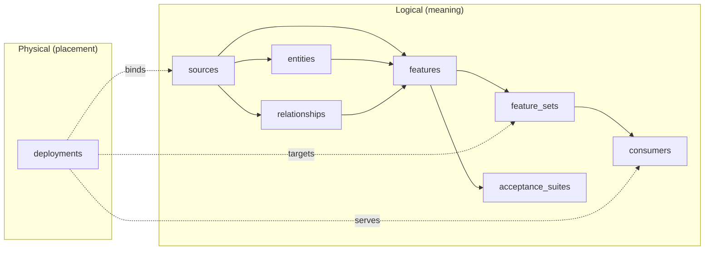

# The specification model

**In plain terms:** a project file is a catalogue. *Sources* describe tables you read,
*entities* say who gets a value (for example a device), *features* say how one value is
computed, *feature sets* group features that are published together, *consumers* say how
applications ask for values, and *deployments* say where it all physically runs. Logical
meaning and physical placement are kept in separate sections so you can move storage without
changing what a feature means.

## Document root

A project is one YAML or JSON document with `kind: FeatureEngineeringProject` and
`spec_version: 0.2.0`. The root collections are `metadata`, `entities`, `sources`,
`relationships`, `features`, `feature_sets`, `consumers`, `deployments` and
`acceptance_suites` (SPECIFICATION §3). The authoritative structure is
`spec/feature-engineering-spec-v0.2.0/schemas/project.schema.json`; featlas embeds all twelve
shipped schemas at build time and never fetches a schema (`crates/featlas-core/src/schema.rs`).

Every object has an `id` and an exact `version`. References must resolve to exactly one object
of the intended kind at the exact version (SEM-ID-001, SEM-ID-002); there are no version ranges
or "latest". Core objects reject unknown fields; namespaced `extensions` carry metadata only and
are never read by the planner or evaluator (DECISIONS D7).

## Sources

A source is a logical table contract: typed `columns` (each with type, nullability, unit,
classification and a description), `primary_key`, `record_semantics`, `time` columns, `quality`,
`retention` and `lineage` (SPECIFICATION §4.1).

* **Types.** `integer` (signed 64-bit), `number` (finite binary64), `boolean`, `string`,
  `timestamp` (UTC, microsecond precision), `date` (SEM-TRANS-006, `value.rs`).
* **Record semantics.** `append_only` (immutable events, `logical_key`, `duplicate_policy`
  `reject` or `collapse_identical`) or `versioned` (revision history with an explicit revision
  order and tombstones). The primary key identifies a stored row; the logical key identifies
  what is reconstructed across revisions (SEM-SRC-002).
* **Time.** `event_time` (when it happened) and `available_time` (when it became knowable);
  see [Time semantics](time.md).
* **Quality.** `null_key_policy`, `invalid_row_policy`, `max_lateness_seconds` and a
  `completeness` mode. Completeness comes from external status evidence, never from row counts.

## Entities and population

An entity declares typed `keys`, each mapped to a population-source column; a tenant key is
flagged `is_tenant: true`. Its `population` names the source that defines who is
eligible at *T*. Entities with zero qualifying events still get an output row (SEM-ENT-001), and
the tenant key is part of every grouping, join, output key and consumer lookup (SEM-ENT-002).

## Relationships

A relationship declares directed source/target column pairs, `cardinality` (`one_to_one` or
`many_to_one` only), `join_type` (`left`, `inner`), `unmatched` (`preserve_null`, `drop`,
`error`), `null_keys` (`unmatched`, `error`), `multiple_matches: error`, and a temporal mode:
`none` or `as_of` (valid-time join at `left_event_time` with a half-open
`[valid_from, valid_to)` interval and the dimension reconstructed at the feature cutoff)
(SEM-REL-001..004). A relationship performs no join by itself; a feature transform references it.

## Features

A feature declares its `entity`, `output` (type, nullability, unit, constraints, numeric
tolerance), aliased `inputs` with the exact columns used, version-pinned `dependencies`, `time`
(window, availability cutoff, publication delay), exactly one `transform`, `lineage`,
`missingness`, `quality` (checks with `error`/`warn` severity and `on_violation: error` or
`quarantine`, see [Quality policies](quality.md)), `history` and acceptance suites
(SPECIFICATION §6).

| Transform | Meaning | Rule |
| --- | --- | --- |
| `aggregate` | `count`, `count_distinct`, `sum`, `mean`, `min`, `max` with a null policy (`ignore`, `propagate`, `error`); exact | SEM-TRANS-004 |
| `recency` | Elapsed seconds since the latest eligible event, `rounding: floor` | SEM-TRANS-005 |
| `lookup` | First row under a declared lexicographic `order_by`; ties are errors (`on_tie: error`) | SEM-TRANS-005 |
| `expression` | Typed AST over same-entity feature dependencies | SEM-TRANS-002/006 |
| `learned`, `custom` | Contracts only: validated, never executed by featlas | SEM-FIT-*, SEM-CUSTOM-* |

Expression operators are fixed by the schema: `add`, `subtract`, `multiply`, `divide`,
`safe_divide`, comparisons, `and`, `or`, `not`, `is_null`, `coalesce`, `if_else`, `absolute`.
Type checking runs before execution; `and`/`or`/`coalesce`/`if_else` are lazy, integer
arithmetic is checked, and non-finite results or division by zero are diagnostics
(`crates/featlas-core/src/expr.rs`).

!!! info "featlas interpretations"
    A feature reference inside a row-level filter or value expression is rejected
    (`UNSUPPORTED_ROW_LEVEL_DEPENDENCY`), and entity-level expressions cannot read source columns
    (`EXPRESSION_SOURCE_INPUT`) (DECISIONS D4).

## Feature sets

A feature set pins member features at exact versions for one entity, with `publication: atomic`:
members are published together as one snapshot.

## Consumers and labels

A consumer pins a feature set version and declares `entity_inputs` (request field per entity
key), `time_inputs` (`as_of`, `requested_at`), `selection.mode` (`source_as_known` or
`historical_serving_replay`, tie-breaker `sequence`), `max_staleness_seconds` and
`missing_value_policy` (`preserve_null` or `reject`). An optional `label` declares a
forward-horizon label kept separate from the feature graph (SEM-LABEL-001). See
[Publication and replay](publication.md).

## Deployments, adapters and roles

A deployment is the physical half. It contains:

* `adapters`: instances with an `id`, a namespaced `implementation`, an exact `version`, the
  `roles` they play and an adapter-specific `configuration` (validated against that exact
  version's configuration schema).
* `execution`: which adapter plays `compute`, `catalog` and (optionally) `orchestrator`.
* `source_bindings`: per source, a location, `read_only: true`, the pinned source version and a
  rename-only `column_mapping` covering every logical column (SEM-PORT-003).
* `output_targets`: per feature set, a location, `role` (`offline_store` or `online_store`),
  `entity_key_mapping`, `feature_mapping` (value and state columns) and the five
  `metadata_columns` (`as_of`, `published_at`, `publication_sequence`, `publication_id`,
  `materialization_id`) (SEM-PORT-004).
* `consumer_bindings`, `schedule` (`manual` or `interval`), `refresh`, `publication`
  (atomicity `feature_set`, `observed_timestamp_required: true`, surface `offline_snapshot` or
  `online_store`), `backfill`, `runtime.required_capabilities`, `slo`, `budget`, `monitoring`,
  `access`, `output_retention_seconds` and `portability` (`portable` or `allow_native`).

Roles are `compute`, `catalog`, `offline_store`, `online_store` and `orchestrator`
(`crates/featlas-core/src/model.rs`, `Role`). The installed adapters are:

| Implementation | Roles | Notes |
| --- | --- | --- |
| `dev.featlas:local_reference@0.1.0` | compute, catalog, offline_store | The core's exact evaluator; read-only fixture sources; JSON Lines output with atomic rename (`local.rs`) |
| `dev.featlas:memory_store@0.1.0` | offline_store | In-process test double for rebinding proofs; not a production store |
| `dev.featlas:databricks@0.1.0` | compute, catalog, offline_store, orchestrator | Spark SQL lowering and Unity Catalog statements; orchestrator declared only (`databricks.rs`) |

The core resolves adapters only through registry traits keyed by the exact
`(implementation, version)` pair and never dispatches on vendor names (SEM-PORT-001/002,
DECISIONS D1).

## Acceptance suites

Suites hold isolated cases: population and source rows, `source_status` evidence, an `as_of`,
a context (mode, consumer, publications for replay cases) and either expected rows (full entity
key, value, state) or an expected diagnostic code (SPECIFICATION §12). Suites whose runner is
`adapter_required` are not run by the local evaluator and are reported `not_executed`
(`crates/featlas-core/src/fixtures.rs`). See [Testing and evidence](../testing.md).
