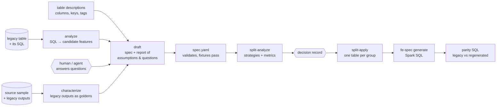

# Reverse engineering existing feature tables

**In plain terms:** most teams already have feature tables built by SQL that nobody fully
remembers. `featlas_reverse` reads that SQL and the table descriptions, writes a featlas spec for
the same features, and lists every guess it had to make so a person can confirm it. It can then
cut a very wide table into several smaller ones, regenerate them from the spec, and produce a
read-only SQL query that proves the new tables give the same numbers as the old one — or shows
exactly where the old table was wrong (for example, it counted data that arrived too late).

## Who uses which part

| You are… | Read |
| --- | --- |
| A data/ML engineer porting a table | [Drafting a spec](drafting.md), [Characterization tests](characterization.md) |
| Deciding how to split a 100-column table | [Splitting wide tables](splitting.md) |
| A platform engineer rebuilding tables | [Regeneration and parity](regenerate.md), [Databricks guide](../guides/databricks.md) |
| A reviewer | [Worked example](example.md) — every artifact is checked in — and the evidence below |
| An agent / tool integrator | [Reference](reference.md): CLI, MCP tools, skills |

## Ground rules (from the code and skills)

* **Read-only.** The CLI and MCP tools take inline documents and return results; they never read
  from or write to a warehouse or catalog (`python/featlas_reverse/mcp_server.py` docstring).
  Running generated or parity SQL is the caller's job, with its own authorized connection.
* **Nothing is guessed silently.** SQL outside the supported shape goes to `unsupported`; every
  default the drafter takes is an `assumption`; gaps it cannot fill are `questions`
  (`draft.py` docstring).
* **No re-implemented semantics.** The core (through the `featlas` bindings) validates, tests and
  generates (`featlas_reverse/__init__.py`).
* **Acceptance cases are never invented.** The drafter emits structural cases and, when given
  samples, characterization cases whose goldens are the legacy table's own outputs.
* **The legacy table is never modified.** The regenerated table defaults to
  `<legacy>_featlas`; cutover is a human decision (skills `featlas-reverse-engineer`,
  `featlas-regenerate`).
* Drafts carry `metadata.status: draft` until a human has reviewed the assumptions.

## Evidence

| Test | What it proves |
| --- | --- |
| `python/tests/test_reverse.py::test_draft_reproduces_legacy_outputs` | The legacy SQL runs unchanged on local Spark over synthetic sources; the drafted spec, with characterization cases from the legacy outputs, passes all fixtures in the core; every aggregate has a legacy-golden case |
| `…::test_split_by_domain_regenerates_legacy_values` | `tag:domain` is ranked first with 6 groups; every split table is regenerated through the generated Spark SQL; regenerated values equal the legacy table column by column; the generated parity SQL reports 3 rows compared, 0 missing, 0 mismatches |
| `…::test_late_arrival_is_a_reported_legacy_divergence` | An order that arrived after `as_of` is counted by the legacy SQL but not by the spec; the difference surfaces as characterization failures for that tenant only |
| `python/tests/test_reverse_mcp.py::test_agent_workflow_over_mcp` | The MCP server end to end: draft → split analyze → split apply → parity SQL → generate, all inline; invalid input returns `isError` |

CI runs `test_reverse_mcp.py` in the `python-bindings` job and `test_reverse.py` in the
`spark-differential` job (`.github/workflows/ci.yml`). All four tests passed when run locally
while writing these pages (not recorded under `docs/evidence/`).
